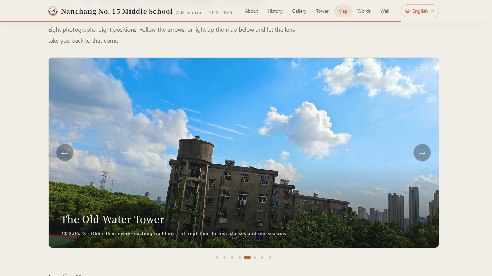
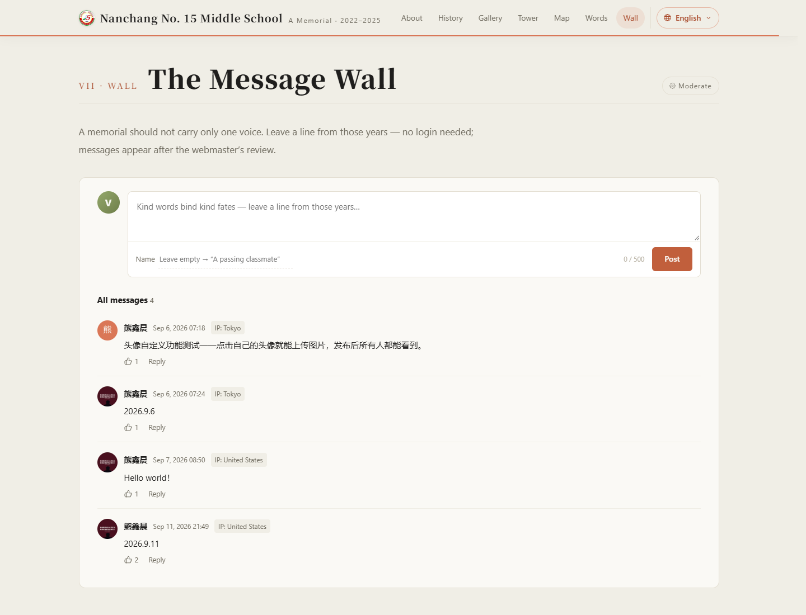

<sub>🌐 <a href="README.md">中文</a> · <b>English</b></sub>

<div align="center">

# Memorial by Qingshan Lake

> *“An alma mater is the campus you only begin to miss endlessly after you have left it.”*

[](https://xxc2007.me/nc15/en/)
[](LICENSE)
[](#️-tech-stack)
[](#guestbook-self-hosted-artalk)
[](https://github.com/xxc2007)
[](https://www.douyin.com/user/MS4wLjABAAAA-AYW1RCpFjwJmoMTnZy1vKmOQopmBOUjPLN9phlDpjI)
[](https://www.xiaohongshu.com/user/profile/63bac6500000000026006c47)
[](https://space.bilibili.com/31961476)
[](https://x.com/xxc2007)
[](https://www.youtube.com/@xxc2007)

**Keeping three years of school life at an address you can always return to.**

A private digital chronicle dedicated to **Nanchang No. 15 Middle School**—


featuring **25 original campus photographs**, an **eight-viewpoint Tour Through Time**, a **multi-source campus map (MapLibre GL)**,


and a **login-free anonymous guestbook** where alumni can leave a note from anywhere in the world.

Built in pure HTML, CSS, and vanilla JavaScript with structure, style, and behavior cleanly separated (`index.html` + `assets/`)—


zero frameworks, zero build step. Clone the repo, start any static server, and open the album.

[Live Site](https://xxc2007.me/nc15/en/) · [Promo Film](#-promo-showcase) · [Highlights](#-highlights) · [Site Structure](#-site-structure) · [Tech Stack](#️-tech-stack) · [Run Locally](#-run-locally) · [Design Notes](#-design-notes) · [Migration Guide](docs/MIGRATION.en.md)

</div>

<p align="center">

</p>
<p align="center"><sub>
▲ Hero · warm cream paper (#F0EEE6), terracotta accents (#D97757), and serif display typography
</sub></p>

## 🎬 Promo Showcase

This 35-second English cut mirrors the original film shot for shot: the emblem and hero first, then the history timeline, 25 campus photographs, the water tower across day and dusk, an eight-point campus map, and a privacy-safe guestbook demo before the whole memorial comes back together. It uses the English page captures and the same real campus photography, rhythm and paper-like transitions.

Open the English player below to watch online.

https://raw.githubusercontent.com/xxc2007/In-memory-of-Nanchang-No.-15-Middle-School/main/docs/promo/nanchang15-promo-en-readme.mp4

▶️ [Open the English 1080p HD player](https://xxc2007.me/promo/en/) · [Open the English 1080p source video directly](https://raw.githubusercontent.com/xxc2007/In-memory-of-Nanchang-No.-15-Middle-School/main/docs/promo/nanchang15-promo-en.mp4)

The English standalone player and source link use the complete 1920×1080 master; the README preview is a high-quality 1080p copy prepared for GitHub's inline playback limits.

## ✨ Highlights

### 📖 A Printed-Album Reading Experience

* **Seven curated chapters**: *Overview → History → Campus Gallery (25 photographs across six themes) → The Water Tower (a charcoal-dusk emotional interlude) → Campus Map → Epilogue → Guestbook*.

* **Ten idiomatic language editions**: Dedicated static pages for Simplified Chinese (`/`), Traditional Chinese (`/zh-Hant/`), English (`/en/`), Japanese (`/ja/`), Korean (`/ko/`), Russian (`/ru/`), Spanish (`/es/`), French (`/fr/`), Portuguese (`/pt/`), and Arabic (`/ar/`, full RTL).

  * The top-bar globe dropdown lists every language in its native script with a terracotta checkmark on the active edition, wrapped in `translate="no"` so browser translation extensions never distort the menu.

  * All ten editions link mutually via `hreflang` and `sitemap.xml`, localize dynamic UI copy automatically via `<html lang>`, and converge on **one shared guestbook**.

* **Warm editorial restraint**: Cream paper (`#F0EEE6`), terracotta brick red (`#D97757`), serif headlines, crisp hairlines, three responsive breakpoints, a print-for-binding stylesheet, and full `prefers-reduced-motion` support.

### 🗺 Campus Tour (Photo Tour + Multi-Source Map)

* **Eight-spot full-frame photo tour**: Eight campus viewpoints with a gentle Ken Burns push, navigable by arrows, dots, or keyboard keys.

* **Multi-source MapLibre campus map**: Centered on the Qingshanhu campus (`28.7208°N, 115.9322°E`, with runtime Gaode coordinate conversion), switching seamlessly across Gaode roads, Tianditu roads/satellite, current Esri imagery, and **2023 Wayback historical imagery** while staying linked to all 8 viewpoints. An optional 3D view overlays OpenFreeMap building footprints and estimated heights *(illustrative, not surveyed heights)*, with campus reset, loading states, and retry handling. See [map source configuration](docs/MAP-SOURCES.md).

* **Zero initial map overhead**: Self-hosted MapLibre GL v5 loads lazily only as you approach the map section; all viewpoint coordinates and 10-language captions live cleanly in the `SPOTS` array of `assets/map.js`.

<p align="center">

</p>
<p align="center"><sub>
▲ A Tour Through Time · The Old Water Tower viewpoint (5 / 8) with Ken Burns motion and localized caption
</sub></p>

### 💬 Guestbook (Self-Hosted Artalk)

* **No login required**: Leave a note even without entering a name or email—the frontend assigns a gentle anonymous identity automatically (consistent per nickname).

* **Moderated for calm**: New notes enter a pending queue and appear publicly once approved by the site owner.

* **Zero third-party tracking**: Artalk runs on a self-hosted server, keeping every message under your own roof.

<p align="center">

</p>

### 🎬 Tactile Interactions (Vanilla JS, Zero Dependencies)

| Interaction | Craft & Behavior | 
| ----- | ----- | 
| **Reading progress** | A terracotta hairline beneath the top bar grows smoothly via `scaleX` as you read | 
| **Language dropdown** | Keyboard-complete (`Esc`, `↑↓`, `Home`, `End`, outside-click dismiss); gracefully degrades to a static row without JS | 
| **Section scrollspy** | Highlights the active chapter automatically as you move through the album | 
| **Count-up figures** | Hero numbers ease cleanly from `0 → 1958 / 51 / 2600+ / 25` (`easeOutQuart`) | 
| **Hero parallax** | The opening campus panorama drifts at `0.5×` scroll speed with `scale(1.09)` edge protection | 
| **Growing timeline** | The historical rule draws itself downward, lighting up each milestone year as it passes | 
| **Zoom-and-pan lightbox** | Cursor-centered `1–4×` wheel zoom, double-click zoom, drag pan, pinch zoom, and clamped bounds coexisting cleanly with swipe navigation | 
| **Gallery fade & tilt** | Photographs fade in softly upon load; desktop cards tilt subtly beneath the cursor | 

All motion runs inside a single `requestAnimationFrame` scroll loop and steps back quietly whenever reduced motion is requested.

## 🗂 Site Structure

```
site/
├── index.html          # Simplified Chinese edition (only two inline scripts: JSON-LD and map lazy-loader)
├── zh-Hant/index.html  # Traditional Chinese edition (Taiwan lexical conventions)
├── en/index.html       # English edition (shared assets via ../ relative paths, file:// friendly)
├── ja/index.html       # Japanese edition (natural Japanese editorial phrasing)
├── ko/index.html       # Korean edition (natural Korean phrasing)
├── ru/index.html       # Russian edition (natural Russian phrasing & transliteration)
├── es/index.html       # Spanish edition (idiomatic Spanish)
├── fr/index.html       # French edition (idiomatic French)
├── pt/index.html       # Portuguese edition (idiomatic Portuguese)
├── ar/index.html       # Arabic edition (full RTL layout and Arabic font stack)
├── 404.html            # Self-contained 404 page (inline styles, zero external requests, links to all editions)
├── assets/
│   ├── style.css       # Full design system (tokens, components, breakpoints, print-for-binding, fallbacks)
│   ├── main.js         # Core interactions (progress, scrollspy, language menu, parallax, inertia, lightbox)
│   ├── map.js          # Photo tour & lazy-loaded MapLibre campus map (ten-language SPOTS data)
│   └── wall.js         # Guestbook frontend talking to self-hosted Artalk (ten-language dynamic copy)
├── images/
│   ├── full/           # 25 exhibited photographs (plus 4 spare shots: 10 / 22 / 23 / 25)
│   ├── thumbs/         # Matching lightweight thumbnails
│   ├── og-card.jpg     # 1200 × 630 text-free share card shared across all ten languages
│   └── emblem-*.png    # School emblem assets (header, hero, footer, favicon)
├── maplibre/           # Self-hosted MapLibre GL v5 (zero external CDN dependency)
├── docs/               # README screenshots + migration guide (docs/MIGRATION.en.md)
│   └── promo/          # Chinese & English players, 1080p showcase cuts, and full masters (/promo/ & /promo/en/)
├── README.md / README.en.md   # Bilingual repository documentation
└── robots.txt / sitemap.xml / LICENSE / .gitattributes / .gitignore

```

## ⚙️ Tech Stack

| Layer | Selection | 
| ----- | ----- | 
| **Frontend** | Pure HTML / CSS / vanilla JS—structure, style, and behavior separated, zero build | 
| **Mapping** | Self-hosted [MapLibre GL](https://maplibre.org) v5 + AutoNavi (Gaode) Chinese raster tiles, lazy-loaded | 
| **Guestbook** | Self-hosted [Artalk](https://artalk.js.org) v2.10 + SQLite | 
| **Serving** | Nginx reverse proxy `/comment/` → `systemd` daemon | 
| **Hosting** | Azure VM · Cloudflare DNS · Let's Encrypt HTTPS | 

### How It Works

The diagram separates the memorial into three clear paths: static reading (photographs and prose), the on-demand map tour linked to viewpoint metadata, and the self-hosted guestbook with moderation. Green marks reader-visible results; amber marks moderation, failure fallbacks, or constraints.

[Campus memorial · Content, maps and guestbook](https://raw.githubusercontent.com/xxc2007/In-memory-of-Nanchang-No.-15-Middle-School/main/docs/architecture/flow.en.f4b5cfe43280.png)

Click to open the 3600 px PNG, then click again for full resolution · [Editable SVG source](docs/architecture/flow.en.svg). Implementation references: [index.html](index.html) · [assets/main.js](assets/main.js) · [assets/map.js](assets/map.js) · [assets/map-sources.js](assets/map-sources.js) · [assets/wall.js](assets/wall.js) · [docs/MAP-SOURCES.md](docs/MAP-SOURCES.md) · [docs/MIGRATION.md](docs/MIGRATION.md).

To update both bilingual diagrams, run `npm ci --prefix docs/architecture`, edit labels in [render.mjs](docs/architecture/render.mjs), and run `node docs/architecture/render.mjs` (see [export notes](docs/architecture/README.md)).

## 🚀 Run Locally

Nothing to install—clone and open:

```
git clone https://github.com/xxc2007/In-memory-of-Nanchang-No.-15-Middle-School.git
cd In-memory-of-Nanchang-No.-15-Middle-School
python -m http.server 8000   # or any static server; open http://localhost:8000

```

> The guestbook requires the self-hosted Artalk backend (`/comment/`), so that section shows a graceful load notice locally while every chapter, gallery, and interaction works in full. Opening `index.html` directly via `file://` also works; only online map tiles and the guestbook require a network connection.

## 📝 Design Notes

* **Visual direction**: Inspired by Claude / Anthropic’s warm editorial restraint (cream paper, terracotta, serif display) from day one. The paper canvas remains uncluttered—motion always yields to the photographs and memories.

* **Static ten-language architecture**: Ten independent static HTML documents instead of runtime JS translation guarantee full semantic clarity and SEO metadata per language. Dynamic UI copy switches via `<html lang>`, while all ten editions share one `page_key` so alumni writing in any language meet on the same wall.

* **Intentional desktop inertial scrolling**: Smooth wheel damping runs only on fine-pointer devices; browser zoom (`Ctrl + wheel`), the map canvas, form inputs, and the lightbox are never hijacked, while touch and reduced-motion users keep native scrolling.

* **Browser support**: Built cleanly for modern evergreen browsers (Chrome, Edge, Firefox, Safari from the past two years) with zero polyfills and no IE / Legacy Edge support.

* **Guestbook fetch cap & timeouts**: Fetches up to 100 comments per request (well suited to a school memorial) while displaying the true server-side total; all network calls carry a 15-second timeout fallback.

* **Self-contained 404**: `404.html` intentionally keeps pill-style language links so it stays 100% self-contained with zero external script or style requests.

* **Spare photograph pool**: `10-brick-building-court`, `22-running-track`, `23-library-gate`, and `25-staff-lane` in `images/full|thumbs` are curated reserves kept ready for future gallery updates.

## 📄 License

[MIT](LICENSE) © 2026 Xiong Xinchen (熊鑫晨) · Campus photographs © Xiong Xinchen

## 📈 Star History

<p align="center">

</p>
<p align="center"><sub>
▲ Generated dynamically by <a href="https://star-history.com">star-history.com</a>; GitHub's image proxy may delay updates by a few hours.
</sub></p>

<div align="center">
<sub>Dedicated to the red-brick buildings, the camphor trees, and the old water tower by Qingshan Lake.<br><a href="https://xxc2007.me/nc15/en/">xxc2007.me/nc15/</a></sub>
</div>