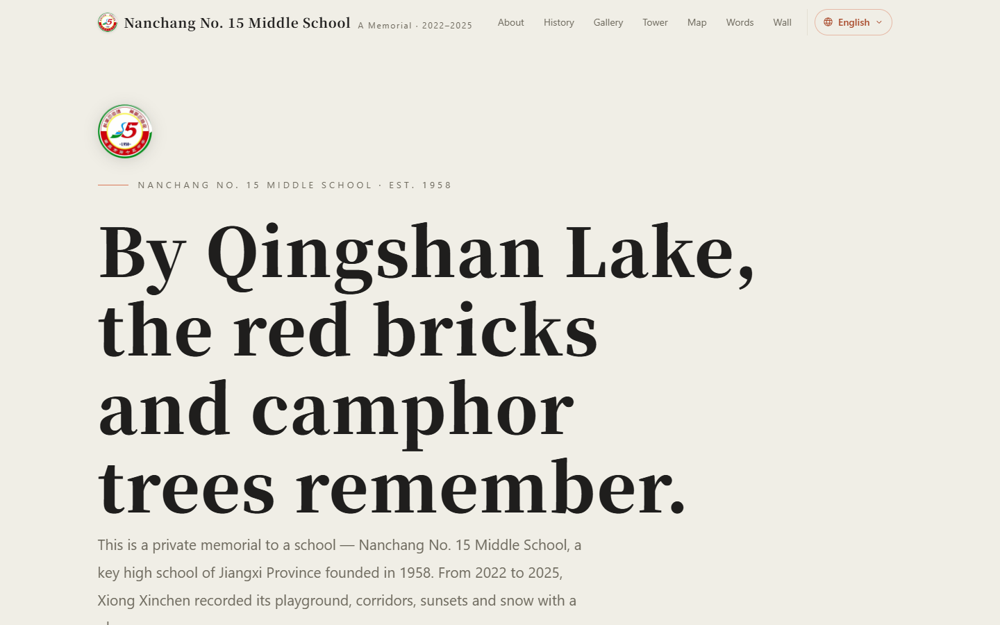
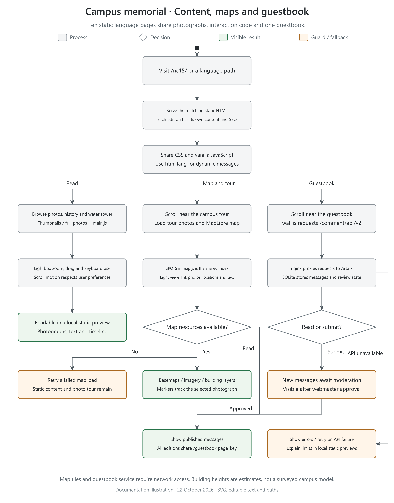

<sub>🌐 <a href="README.md">中文</a> · <b>English</b></sub>

<div align="center">

# Memorial by Qingshan Lake

> *“An alma mater is the campus you only begin to miss endlessly after you have left it.”*

[](https://xxc2007.me/nc15/en/)
[](LICENSE)
[](#site-structure--tech-stack)
[](#highlights)
[](https://github.com/xxc2007)
[](https://www.douyin.com/user/MS4wLjABAAAA-AYW1RCpFjwJmoMTnZy1vKmOQopmBOUjPLN9phlDpjI)
[](https://www.xiaohongshu.com/user/profile/63bac6500000000026006c47)
[](https://space.bilibili.com/31961476)
[](https://x.com/xxc2007)
[](https://www.youtube.com/@xxc2007)

<br>

**Keeping three years of school life at an address you can always return to.**

A private digital chronicle dedicated to **Nanchang No. 15 Middle School**—<br>
featuring **25 original campus photographs** (served in AVIF), an **eight-viewpoint Tour Through Time**, a **multi-source MapLibre campus map**,<br>
and a **login-free anonymous guestbook** shared across ten static languages. Pure HTML, CSS, and vanilla JS—zero frameworks, zero build step.

[Live Site](https://xxc2007.me/nc15/en/) · [Promo Film](#promo-showcase) · [Highlights](#highlights) · [Structure &amp; Stack](#site-structure--tech-stack) · [Run Locally](#run-locally--design-notes) · [Migration Guide](docs/MIGRATION.en.md)

</div>

---

<p align="center">
  
</p>
<p align="center"><sub>▲ Hero · warm cream paper (#F0EEE6), terracotta accents (#D97757), and serif display typography</sub></p>

---

## Promo Showcase

Our new **70-second · 1080p 60fps** official launch film (available in both English and Chinese editions): built 100% from original 2022–2025 campus photographs, the official school emblem, and live English interface captures—opening on the summer plaza and crescent sculpture, moving through the motto classroom, the 1958–2026 growing timeline, six photo chapters, the charcoal-dusk Water Tower diptych (daylight vs. June sunset), the 8-spot map tour, and the 10-language guestbook—scored to an original 88 BPM felt-piano & strings composition with gentle shutter foley.

Watch directly below:

https://github.com/user-attachments/assets/531644c1-bc67-4f7a-a606-18b4e9d47bd8

▶️ [Open the English 1080p HD player](https://xxc2007.me/nc15/promo/en/) · [English 1080p60 MP4](https://raw.githubusercontent.com/xxc2007/In-memory-of-Nanchang-No.-15-Middle-School/main/docs/promo/nanchang15-promo-en.mp4) · [Chinese 1080p60 MP4](https://raw.githubusercontent.com/xxc2007/In-memory-of-Nanchang-No.-15-Middle-School/main/docs/promo/nanchang15-promo.mp4)

---

## Highlights

### Printed-Album Craft & Ten Static Languages

- **Seven curated chapters**: *Overview → History → Gallery (25 photographs across six themes) → The Water Tower (charcoal-dusk interlude) → Campus Map → Epilogue → Guestbook*.
- **Ten idiomatic static editions**: Simplified & Traditional Chinese, English, Japanese, Korean, Russian, Spanish, French, Portuguese, and Arabic (full RTL). The top-bar globe dropdown uses native script names with `translate="no"` protection, mutual `hreflang` + `sitemap` links, and **one shared guestbook**.
- **Speed & tactile care**: Serves AVIF campus photographs with deferred section scripts, three responsive breakpoints, a print-for-binding stylesheet, and full `prefers-reduced-motion` support.

### Campus Tour & Self-Hosted Guestbook

- **Eight-spot photo tour + multi-source map**: Full-frame Ken Burns tour linked to a lazy-loaded, self-hosted MapLibre GL v5 campus map (`28.7208°N, 115.9322°E`) switching across Gaode roads, Tianditu, current Esri imagery, **2023 Wayback historical imagery**, and OpenFreeMap 3D footprints ([map sources](docs/MAP-SOURCES.md)).
- **Login-free Artalk guestbook**: Leave a note without signing in; messages are moderated before display and stored strictly on a self-hosted server with zero third-party tracking.

<p align="center">
  
</p>
<p align="center"><sub>▲ A Tour Through Time · The Old Water Tower viewpoint (5 / 8) with Ken Burns push and English caption</sub></p>

<p align="center">
  
</p>

### Tactile Interactions (Vanilla JS, Zero Dependencies)

| Interaction | Craft & Behavior |
|---|---|
| **Reading progress & scrollspy** | Terracotta top hairline scales smoothly via `scaleX`; active section lights up automatically |
| **Count-up & hero parallax** | Hero figures ease `0 → 1958 / 51 / 2600+ / 25`; `0.5×` parallax with fine-pointer inertial scrolling |
| **Growing timeline & lightbox** | History rule draws downward on scroll; lightbox supports cursor-centered `1–4×` wheel zoom, double-click & pinch |

## Site Structure & Tech Stack

- **Structure**: Ten independent static HTML editions (`/` + 9 language folders); `assets/` (`style.css`, `main.js`, `map.js`, `wall.js`, `section-loader.js`); `images/` (25 exhibited photos + 4 spare shots + school emblem); self-hosted `maplibre/`; `docs/promo/` bilingual films.
- **Stack**: Pure HTML / CSS / vanilla JS (zero build) · self-hosted [MapLibre GL](https://maplibre.org) v5 · self-hosted [Artalk](https://artalk.js.org) v2.10 + SQLite · Nginx + Azure VM + Cloudflare.

### How It Works

[](https://raw.githubusercontent.com/xxc2007/In-memory-of-Nanchang-No.-15-Middle-School/main/docs/architecture/flow.en.f4b5cfe43280.png)

<sub>Click for 3600 px PNG · [Editable SVG source](docs/architecture/flow.en.svg) · Migration steps in [MIGRATION.en.md](docs/MIGRATION.en.md).</sub>

## Run Locally & Design Notes

```bash
git clone https://github.com/xxc2007/In-memory-of-Nanchang-No.-15-Middle-School.git
cd In-memory-of-Nanchang-No.-15-Middle-School
python -m http.server 8000   # open http://localhost:8000/en/ (guestbook requires live Artalk backend)
```

- **Motion yields to memory**: Pure cream paper surface with no decorative clutter; desktop inertial scrolling never hijacks zoom, map pan, inputs, or the lightbox.
- **Ten languages, one shared wall**: All ten static editions share a single `page_key` so alumni worldwide meet in the same place; `404.html` remains 100% self-contained with zero external requests.
- **Curated spare pool**: `10-brick-building-court`, `22-running-track`, `23-library-gate`, and `25-staff-lane` are reserved for future gallery editions.

## License

[MIT](LICENSE) © 2026 Xiong Xinchen (熊鑫晨) · Campus photographs © Xiong Xinchen

---

<div align="center">
  <sub>Dedicated to the red-brick buildings, the camphor trees, and the old water tower by Qingshan Lake.<br><a href="https://xxc2007.me/nc15/en/">xxc2007.me/nc15/</a></sub>
</div>
