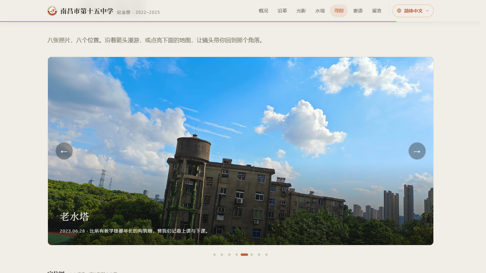
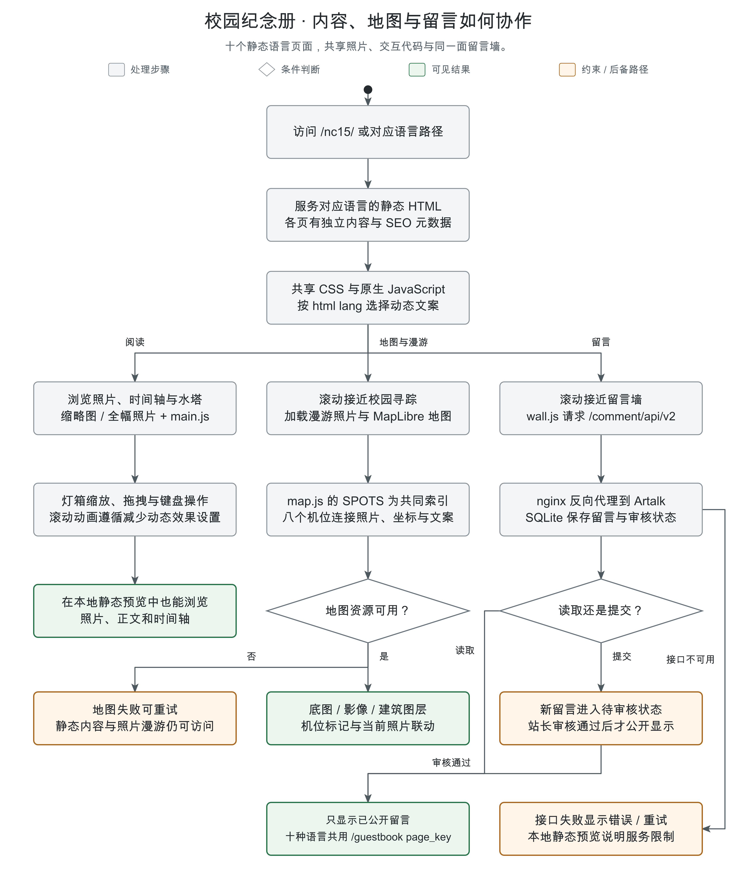

<sub>🌐 <b>中文</b> · <a href="README.en.md">English</a></sub>

<div align="center">

# 青山湖畔的纪念册

> *「所谓母校，就是那座你离开之后才开始无限怀念的校园。」*

[](https://xxc2007.me/nc15/)
[](LICENSE)
[](#-站点结构与--技术栈)
[](#-特色)
[](https://github.com/xxc2007)
[](https://www.douyin.com/user/MS4wLjABAAAA-AYW1RCpFjwJmoMTnZy1vKmOQopmBOUjPLN9phlDpjI)
[](https://www.xiaohongshu.com/user/profile/63bac6500000000026006c47)
[](https://space.bilibili.com/31961476)
[](https://x.com/xxc2007)
[](https://www.youtube.com/@xxc2007)

<br>

**把三年光阴，放进一个可以随时回去的地址。**

这是一本献给**南昌市第十五中学**的私人数字校史画册——<br>
收录 **25 张亲手拍摄的校园实景**（支持 AVIF 极速呈现）、一段 **8 机位时光漫游**、一张 **多源中文定位图**，<br>
以及一面 **无需登录、十语读者共写的匿名留言墙**。纯 HTML / CSS / Vanilla JS，零框架、无构建步骤。

[在线访问](https://xxc2007.me/nc15/) · [宣传片](#-宣传片展示) · [特色](#-特色) · [站点结构](#-站点结构与--技术栈) · [技术栈](#-站点结构与--技术栈) · [本地运行](#-本地运行与--设计笔记) · [设计笔记](#-本地运行与--设计笔记) · [迁移手册](docs/MIGRATION.md)

</div>

---

<p align="center">
  
</p>
<p align="center"><sub>▲ 首屏 · 米白纸感（#F0EEE6）+ 赤陶橙（#D97757）+ 衬线大标题</sub></p>

---

## 🎬 宣传片展示

全新 **70 秒 · 1080p 60fps** 官方宣传片（同步提供中文版与英文版）：全部采用 2022–2025 年亲手拍摄的校园实景原图、真实南昌十五中校徽与实拍交互界面——从青山湖畔的红砖楼与月牙雕塑启封，走过校训教室、1958–2026 生长时间轴、六大光影画廊、深炭灰「老水塔昼夜双图」情绪转折、八机位地图与十语留言墙，最后在粉金色晚霞教学楼底纹中温暖落版。配以原创 88 BPM 毛毡钢琴与室内乐弦乐配乐及胶片快门音效。

点击下方播放器即可在线观看：

https://github.com/user-attachments/assets/315a3688-17a8-451d-840a-e3a9e23013a9

▶️ [打开 1080p 高清播放器](https://xxc2007.me/nc15/promo/) · [中文版 1080p60 MP4](https://raw.githubusercontent.com/xxc2007/In-memory-of-Nanchang-No.-15-Middle-School/main/docs/promo/nanchang15-promo.mp4) · [英文版 1080p60 MP4](https://raw.githubusercontent.com/xxc2007/In-memory-of-Nanchang-No.-15-Middle-School/main/docs/promo/nanchang15-promo-en.mp4)

---

## ✨ 特色

### 📖 纸感画册与十语静态架构

- **七幕叙事**：`概况` → `沿革` → `光影`（25 张实景，六大专题组）→ `水塔`（深炭灰暗色专题）→ `寻踪` → `寄语` → `留言墙`。
- **十种语言独立静态页**：覆盖简/繁/英/日/韩/俄/西/法/葡/阿（全 RTL）十份独立页面，顶栏地球下拉菜单以本族名呈现并标记 `translate="no"` 防插件错位，互持 `hreflang` 与 `sitemap` 交替链接，十版共用同一面留言墙。
- **性能与排版细节**：全站采用米白纸感与赤陶橙视觉语言，支持 AVIF 校园摄影渐进加载、分节脚本按需延迟、三档响应式断点、纸质打印成册样式与 `prefers-reduced-motion` 降级。

### 🗺 校园寻踪与 💬 自托管留言墙

- **八机位时光漫游 + 多源定位图**：8 张全幅摄影配 Ken Burns 缓推镜头；自托管 MapLibre GL v5 按需加载，支持高德道路、天地图卫星、Esri 实时卫星、**2023 年历史影像**与 OpenFreeMap 3D 建筑轮廓切换（配置见[地图维护说明](docs/MAP-SOURCES.md)）。
- **免登录 Artalk 留言墙**：不填昵称邮箱亦可落笔，新留言先审后显，数据完全托管于个人服务器，零第三方追踪。

<p align="center">
  
</p>
<p align="center"><sub>▲ 伍 · MAP 时光漫游 · 老水塔机位 · 底部渐影图注与 5/8 进度计数</sub></p>

<p align="center">
  
</p>
<p align="center"><sub>▲ 柒 · WALL 留言墙 · 免登录匿名留言 · 头像 / IP 属地 / 北京时间</sub></p>

### 🎬 原生交互细节（零外部框架）

| 交互 | 手感与实现 |
|---|---|
| **阅读进度 & 导航高亮** | 顶栏赤陶橙细线 `scaleX` 随滚动延展，scrollspy 自动点亮当前章节 |
| **数字滚动 & 首图视差** | `0 → 1958 / 51 / 2600+ / 25` 缓动定格；首图 `0.5×` 反向视差与惯性平滑滚动 |
| **时间线生长 & 灯箱缩放** | 沿革竖线随滚动徐徐画下；灯箱支持以光标为中心 `1–4×` 滚轮缩放、双击放大与双指捏合 |

## 🗂 站点结构与 ⚙️ 技术栈

- **结构**：根目录及 `zh-Hant/` `en/` `ja/` `ko/` `ru/` `es/` `fr/` `pt/` `ar/` 十份独立静态页；`assets/`（`style.css` / `main.js` / `map.js` / `wall.js` / `section-loader.js`）；`images/`（25 张全幅实景 + 4 张备用底片 + 校徽）；`maplibre/` 自托管引擎；`docs/promo/` 双语宣传片。
- **技术栈**：纯 HTML / CSS / Vanilla JS（零构建）· 自托管 [MapLibre GL](https://maplibre.org) v5 + 高德/天地图/Esri 瓦片 · 自托管 [Artalk](https://artalk.js.org) v2.10 + SQLite · Nginx + Azure VM + Cloudflare。

### 底层原理与运行流程

[](https://raw.githubusercontent.com/xxc2007/In-memory-of-Nanchang-No.-15-Middle-School/main/docs/architecture/flow.zh.897ac732d190.png)

<sub>点击打开 3600px 高清原图 · [可编辑 SVG 源文件](docs/architecture/flow.zh.svg) · 迁移步骤见 [MIGRATION.md](docs/MIGRATION.md)。</sub>

## 🚀 本地运行与 📝 设计笔记

```bash
git clone https://github.com/xxc2007/In-memory-of-Nanchang-No.-15-Middle-School.git
cd In-memory-of-Nanchang-No.-15-Middle-School
python -m http.server 8000   # 打开 http://localhost:8000（留言墙需线上 Artalk 服务）
```

- **动效让位于记忆**：纸面保持纯净无杂饰；桌面惯性滚动仅作用于精确指针，不劫持缩放、地图与灯箱。
- **十语共写一面墙**：十份静态页共享同一 `page_key`，让散落各地的校友在同一个角落重逢；`404.html` 刻意保持零外部请求自包含。
- **备用底片池**：`10-brick-building-court`、`22-running-track`、`23-library-gate`、`25-staff-lane` 保留为后续增补画廊的优先素材。

## 📄 License

[MIT](LICENSE) © 2026 熊鑫晨（Xiong Xinchen）· 校园实景摄影版权归熊鑫晨所有。

## 📈 Star History

<p align="center">
  
</p>

---

<div align="center">
  <sub>献给青山湖畔的红砖楼、香樟与老水塔。<br><a href="https://xxc2007.me/nc15/">xxc2007.me/nc15/</a></sub>
</div>
